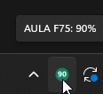

# AULA Battery Widget

## Getting started

If you already have `AulaF75Battery.exe`, double-click it. No build or test commands are needed to use the app.

Run `AulaF75Battery.exe` for an AULA keyboard battery indicator in the Windows tray. Right-click **Keyboard model** to choose your keyboard. Hover to see its level, click for details, or right-click for refresh, optional startup with Windows, and exit. The executable name stays the same to preserve existing startup shortcuts.

The default profile is F75. Your selection is remembered. Receiver IDs are shared across keyboards, so the app does not guess the model from a USB ID. It tracks one selected keyboard at a time; if multiple compatible receivers are connected, use the **Receiver** menu to select one.

## Showcase

The icon shows a green percentage, red at 20% or below, a blue `+` when connected to power, or a grey `?` when unavailable. Remembered readings are labeled **last seen** with their timestamp in the details window. Windows may initially place the icon in its hidden-icons menu.

The keyboard is read once a minute. Low-battery notifications reset after connecting to power or recovery above 25%. Closing the details window leaves the tracker running.

## Supported models

- F75
- F99 Pro
- F75 Max
- S75 Pro
- F87
- F87 Pro
- F65
- F75 Pro
- F99
- F108
- F108 Pro
